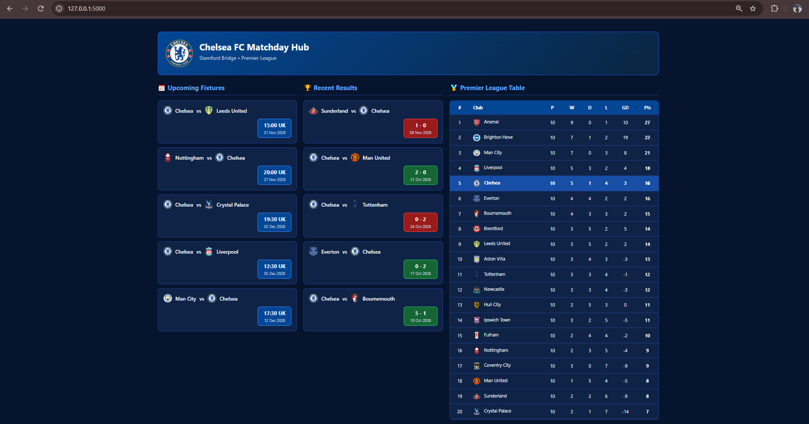

# Chelsea FC Matchday Hub ⚽

A Flask-based web application that displays Chelsea FC's upcoming Premier League fixtures, recent match results, and Premier League standings using the [football-data.org](https://www.football-data.org/) API.

Built as a hands-on project to learn Flask, REST API integration, Jinja2 templating, and Python web application deployment.

## 📸 Screenshot



## ✨ Features

- **Upcoming Fixtures:** Displays Chelsea's next five Premier League matches, including opponents, dates, and kickoff times.
- **Recent Results:** Shows the last five Premier League results with color-coded score badges:
  - 🟢 Green — Win
  - 🔴 Red — Loss
  - ⚪ Grey — Draw
- **Premier League Standings:** Displays the league table with Chelsea's position highlighted.
- **Team Crests:** Displays club badges alongside team names.
- **Responsive Design:** Three-column desktop dashboard that adapts to smaller screens.
- **API Caching:** Caches football data for 15 minutes to reduce unnecessary API requests.

## 🛠️ Tech Stack

| Technology | Purpose |
|---|---|
| Python | Backend programming |
| Flask | Web framework |
| Jinja2 | HTML templating |
| HTML & CSS | Frontend layout and styling |
| football-data.org | Football data API |
| Requests | HTTP requests |
| Flask-Caching | API response caching |
| uv | Python dependency management |
| Gunicorn | Production WSGI server |

## 🚀 Getting Started

### Prerequisites

- Python 3.10 or newer
- [uv](https://docs.astral.sh/uv/)
- A free [football-data.org API key](https://www.football-data.org/client/register)

### 1. Clone the repository

```bash
git clone https://github.com/keerthan-m-shetty/chelsea-matchday-hub.git
cd chelsea-matchday-hub
```

### 2. Install dependencies

```bash
uv sync
```

### 3. Configure environment variables

Create a `.env` file in the project root:

```env
FOOTBALL_API_KEY=your_api_key_here
```

Replace `your_api_key_here` with your football-data.org API key.

**Never commit your `.env` file to GitHub.**

### 4. Run the application

```bash
uv run python src/chelsea_matchday_hub/app.py
```

Open http://127.0.0.1:5000 in your browser.

## 📁 Project Structure

```text
chelsea-matchday-hub/
├── screenshots/
│   └── dashboard.png
├── src/
│   └── chelsea_matchday_hub/
│       ├── __init__.py
│       ├── app.py
│       └── templates/
│           └── index.html
├── .gitignore
├── .python-version
├── pyproject.toml
├── uv.lock
└── README.md
```

## 📊 Data Source

Football data is provided by [football-data.org](https://www.football-data.org/).

The application uses the Premier League matches and standings endpoints.

The free API tier has request limits, and match data may be delayed. This application is not intended for real-time live scoring.

## 🔮 Future Improvements

- Add match detail pages.
- Add home and away league standings.
- Include Chelsea fixtures from additional competitions.
- Improve error handling and API availability.
- Add automated tests.

## 📄 Disclaimer

This is an independent, educational project and is not affiliated with or endorsed by Chelsea Football Club or the Premier League.
